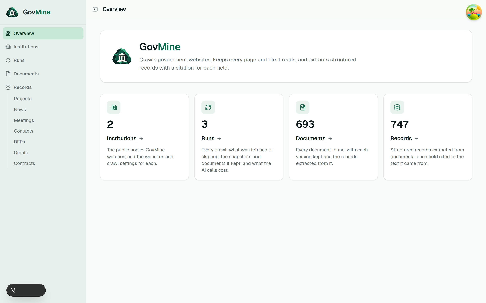
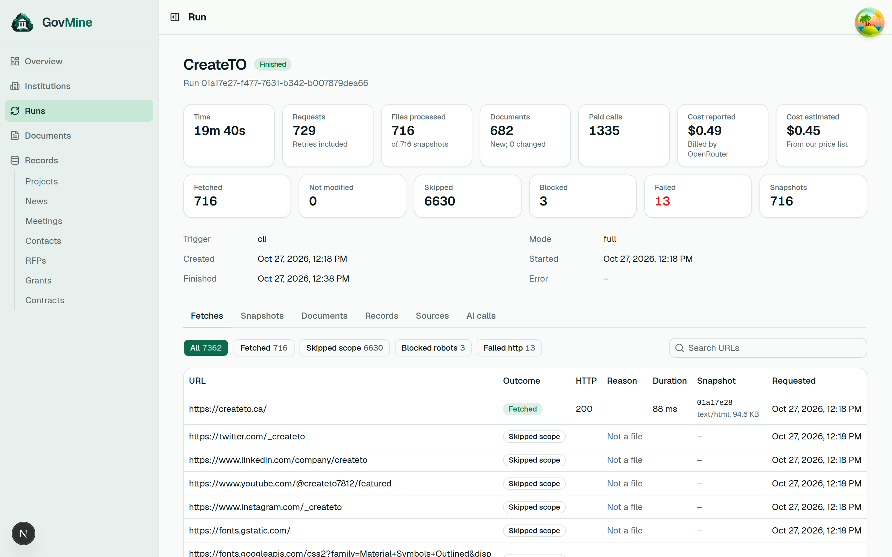
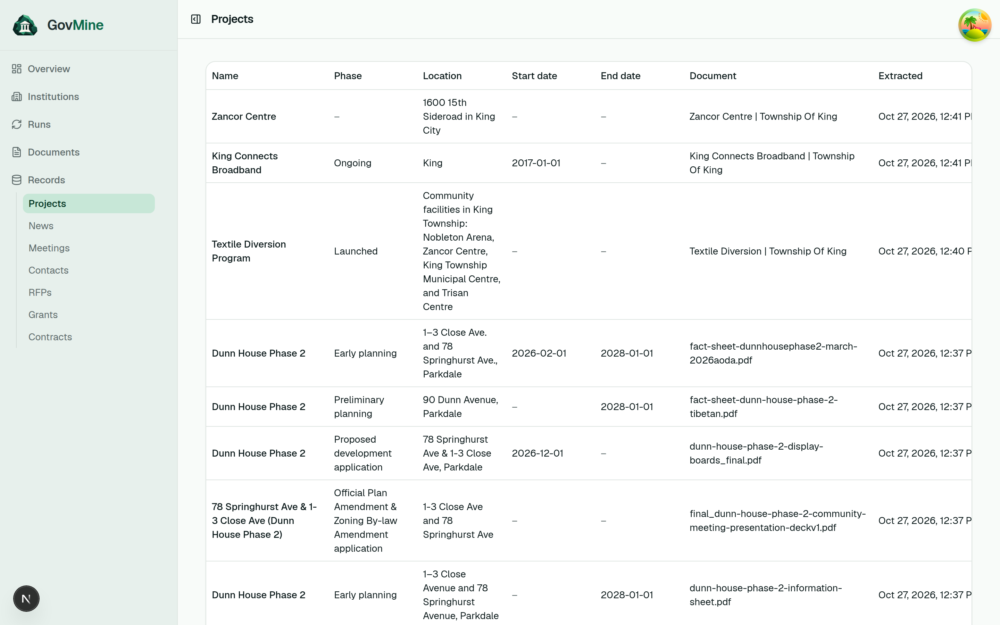
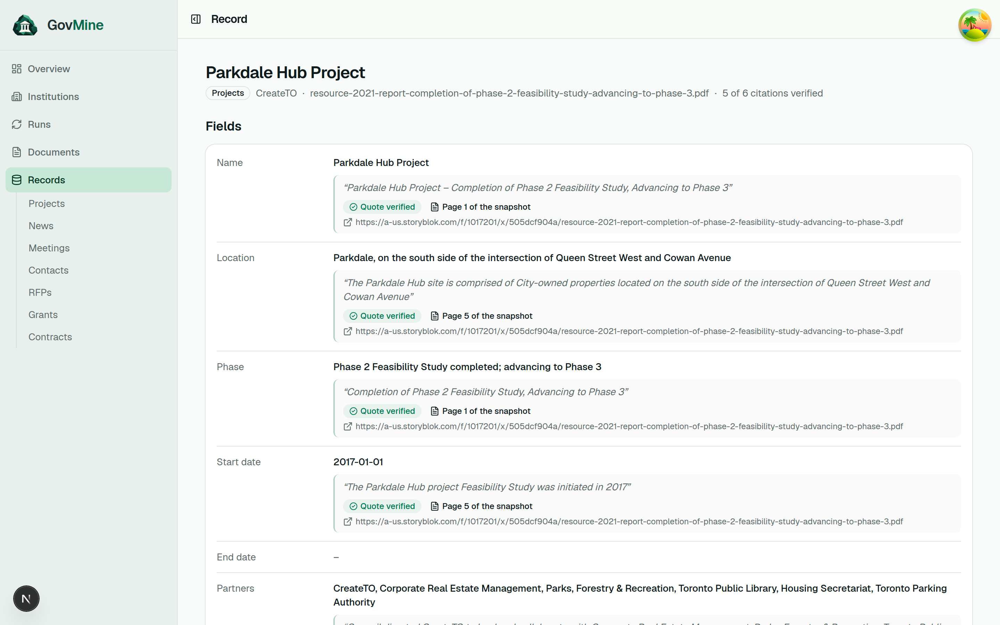
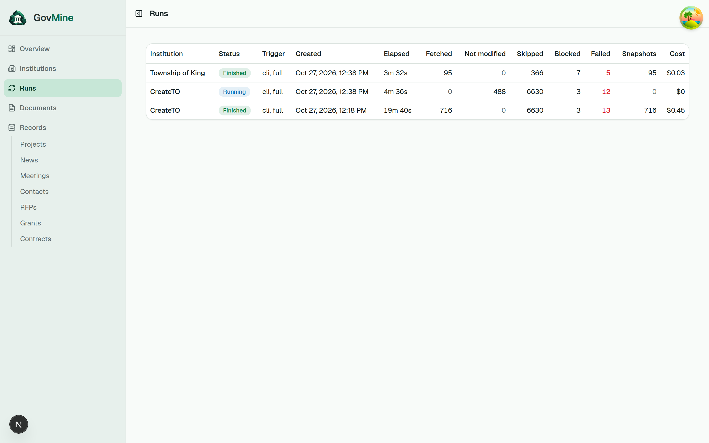
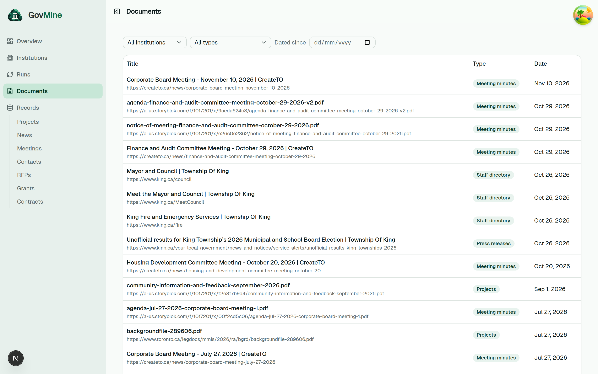

<p align="center">
  
</p>

<h1 align="center">GovMine</h1>

<p align="center">
  <strong>Public institution websites in, cited and versioned records out.</strong><br />
  Crawls a public body's website from its homepage, keeps a copy of every page and linked
  file, and extracts typed records (projects, meetings, contacts, news, RFPs) with a verified
  citation for every field and a history of every change.
</p>

<p align="center">
  <a href="RESULTS.md">Results</a> ·
  <a href="#running-it">Run it</a> ·
  <a href="examples/run-1/">Example output</a> ·
  <a href="docs/specification/README.md">Design</a>
</p>

| Overview                                      | A run: what was fetched, skipped and paid for     |
| --------------------------------------------- | ------------------------------------------------- |
|     |              |
| **Projects, one page per record type**        | **A record: every field cited, with its history** |
|     |             |
| **Runs: the first crawl and the free repeat** | **Documents and their versions**                  |
|             |       |

The first institution is CreateTO. The design is in
[docs/specification/](docs/specification/README.md).

| Concern    | TypeScript                                    | Python                          |
| ---------- | --------------------------------------------- | ------------------------------- |
| Packages   | pnpm via [Vite+](https://viteplus.dev) (`vp`) | [uv](https://docs.astral.sh/uv) |
| Format     | oxfmt (`vp check`)                            | Ruff                            |
| Lint       | oxlint (`vp check`)                           | Ruff                            |
| Type check | tsc (`vp check`)                              | [ty](https://docs.astral.sh/ty) |
| Tests      | Vitest (`vp test`)                            | pytest                          |

## Running it

There are two ways to run gov-mine. Both use the PostgreSQL and RustFS
containers from `apps/server/compose.yaml`.

|              | Use the app                                       | Develop the app                                         |
| ------------ | ------------------------------------------------- | ------------------------------------------------------- |
| Command      | `docker compose --profile app`                    | `vp`                                                    |
| What runs    | API, worker and dashboard from the release images | The same processes on your machine, reloading on change |
| Needs        | Docker with Compose                               | Docker, Node ≥ 24, uv ≥ 0.12 (it downloads Python 3.14) |
| Code changes | Rebuild with `--build`                            | Picked up as you save                                   |

Run one or the other, not both at once: they use the same ports (8000, 3000),
and two workers would take jobs from the same queue.

### Use the app (Docker)

```sh
cd apps/server
# The OpenRouter key for the model steps. Without it, nothing calls a model.
echo 'GOV_MINE_OPENROUTER_API_KEY=sk-or-...' >> .env
docker compose --profile app up --build --detach

docker compose exec api gov-mine seed                       # prints CreateTO's institution id
docker compose exec api gov-mine run create <id> --full     # queue a run; --limit 20 for a short one
docker compose --profile app logs --follow worker           # watch it crawl
```

- Dashboard: http://localhost:3000
- API docs: http://localhost:8000/docs
- Storage console: http://localhost:9001 (`rustfsadmin` / `rustfsadmin`)

`docker compose --profile app down` stops everything and keeps the data in
volumes. Add `--volumes` to delete the data too. The containers use the
default settings from `apps/server/.env.example`, apart from the addresses set
in `compose.yaml`.

### Develop the app (vp)

```sh
vp install && uv sync   # Node and Python dependencies
vp config               # once: activates the pre-commit hook
vp run db:up            # PostgreSQL and RustFS only
vp run db:migrate
vp run dev              # API on :8000, worker, dashboard on :3000, all reloading

cd apps/server && uv run gov-mine seed   # the CLI, against the same database
```

Settings come from `apps/server/.env`. Every line in `.env.example` is also
the default, so with no `.env` at all the app runs locally.

### Commands

```sh
vp run check         # format + lint + typecheck, both languages (check:fix to apply fixes)
vp run test          # Vitest + pytest; one file: vp test <file> or uv run pytest <path>
vp run generate      # regenerate the API client after an API change
vp run ci            # everything CI runs
vp run db:up         # PostgreSQL and RustFS in Docker, needed by integration tests
vp run db:migrate    # alembic upgrade head
vp run dev           # API, worker, and web together
vp run dev:api       # http://127.0.0.1:8000/docs
vp run dev:web       # http://localhost:3000
```

## Layout

Each project has a README with its code map and the rules its code relies on.
Read it before changing the project.

| Project               | What it is                                                   | README                                                         |
| --------------------- | ------------------------------------------------------------ | -------------------------------------------------------------- |
| `apps/server`         | FastAPI app and Procrastinate worker                         | [apps/server/README.md](apps/server/README.md)                 |
| `apps/web`            | Next.js 16 dashboard; the only process with a public address | [apps/web/README.md](apps/web/README.md)                       |
| `packages/api-client` | Typed fetch client generated from the API's OpenAPI schema   | [packages/api-client/README.md](packages/api-client/README.md) |

The browser talks only to `apps/web`, which forwards `/api/*` to `apps/server`.
The two share types only through the generated client.

New projects go in `apps/*`, `packages/*`, or `tools/*`. TypeScript projects
extend a preset from `tsconfig/` and take versions from the catalog in
`pnpm-workspace.yaml`. Python projects are listed under
`[tool.uv.workspace] members` in the root `pyproject.toml`.

## Deploying

One image per app, one command per process, settings from environment variables:

| Process  | Image         | Command                                   | Port |
| -------- | ------------- | ----------------------------------------- | ---- |
| `api`    | `apps/server` | `fastapi run --port 8000 --proxy-headers` | 8000 |
| `worker` | `apps/server` | `gov-mine worker`                         | none |
| `web`    | `apps/web`    | `node apps/web/server.js`                 | 3000 |

Plus managed PostgreSQL and an S3-compatible bucket. Only `web` needs a
public address; it forwards `/api/*` to the API. Run `alembic upgrade head`
from `/app/apps/server` before new code starts. Health checks: `/health/`
(liveness), `/health/{db,storage}` (readiness).

```sh
GOV_MINE_DATABASE_URL=postgresql+psycopg://...
GOV_MINE_STORAGE_ENDPOINT_URL=... GOV_MINE_STORAGE_BUCKET=... GOV_MINE_STORAGE_ACCESS_KEY=... GOV_MINE_STORAGE_SECRET_KEY=...
GOV_MINE_STORAGE_PATH_STYLE=false   # true for MinIO and RustFS
GOV_MINE_OPENROUTER_API_KEY=...     # optional; unset, nothing calls a model
API_URL=http://api.internal:8000    # web only
```

`.github/workflows/images.yml` builds `ghcr.io/<owner>/<repo>/{server,web}`
after CI passes on `main`.

## Supply-chain policy

New package versions are held back for 4 days before install (pnpm
`minimumReleaseAge`, uv `exclude-newer`), and Dependabot runs weekly with the
same cooldown. pnpm runs no dependency build scripts (`strictDepBuilds` with
an empty `allowBuilds`), blocks exotic sub-dependencies, and refuses trust
downgrades. CI uses least-privilege permissions, SHA-pinned actions, and
frozen lockfiles.

## License

[MIT](LICENSE) © builtbystef
