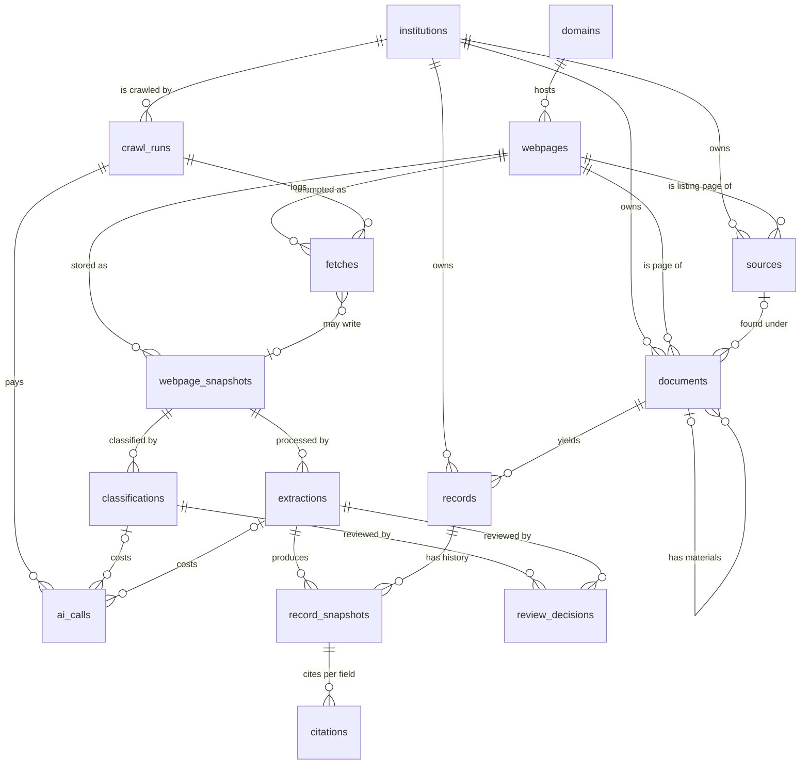

# 5. Data Model

Conventions: PostgreSQL 18, one database. Every table has `id` (UUIDv7) and `created_at`, not
listed below. Enumerations are checked strings. Procrastinate's job tables sit alongside. Bytes
and text live in object storage keyed by snapshot id: `bytes/<snapshot id>` and `text/<snapshot
id>/<page>`. Fifteen tables. Anything one query can answer is not a column.

## 5.1 The shape

| Layer                          | Tables                                                                       | A row is                                                                                            |
| ------------------------------ | ---------------------------------------------------------------------------- | --------------------------------------------------------------------------------------------------- |
| Subject                        | `institutions`                                                               | A public body and its website.                                                                      |
| The web, as fetched            | `domains`, `webpages`, `fetches`, `webpage_snapshots`                        | A log of what the crawler did. Never a claim. Never owned by an institution.                        |
| What the institution published | `sources`, `documents`                                                       | A listing page worth revisiting, and a page or file worth keeping. Owned by one institution.        |
| What we know                   | `classifications`, `extractions`, `records`, `record_snapshots`, `citations` | What each page is, and typed data from each document, each field pointing at a page and an excerpt. |
| Review                         | `review_decisions`                                                           | A person's approve or reject of one classification or extraction.                                   |
| Work                           | `crawl_runs`, `ai_calls`                                                     | One run over one institution; one paid call.                                                        |

## 5.2 Types

Two enums in code, not tables. The columns that use them are checked strings, so a new value is
a code change and a migration of the check constraint.

| Enum              | Used by                                            | Values                                                                                                                                                                                                                                                                                                                                                                                                                                                                                                                                                                                                                                              |
| ----------------- | -------------------------------------------------- | --------------------------------------------------------------------------------------------------------------------------------------------------------------------------------------------------------------------------------------------------------------------------------------------------------------------------------------------------------------------------------------------------------------------------------------------------------------------------------------------------------------------------------------------------------------------------------------------------------------------------------------------------- |
| `InstitutionType` | `institutions.institution_type`                    | `state`, `state_agency`, `county`, `city`, `police_agency`, `fire_department`, `special_district`, `k12_district`, `higher_education`, `municipal_agency`.                                                                                                                                                                                                                                                                                                                                                                                                                                                                                          |
| `DocumentType`    | `sources.document_type`, `documents.document_type` | `purchase_order`, `meeting_minutes`, `budget`, `procurement_guidelines`, `youtube`, `rfp`, `grants`, `press_releases`, `projects`, `project_material`, `annual_report`, `strategic_plan`, `staff_directory`. A `staff_directory` is a page listing the people who work for or govern the institution (staff directory, team, leadership, board or council) with their roles and contact details. A `project_material` is a file listed in a project's materials; the project's extraction assigns it, never the classifier. `project_material`, `annual_report` and `strategic_plan` are kept but have no record type yet; they feed signals later. |

A source borrows the type of the documents it lists. There is no list of which types an
institution should have: the crawl reads the whole site, so whatever it publishes is found and
typed on the way, and coverage is reported from what exists.

## 5.3 Institutions

| Field                      | Notes                                                                                                                                                  |
| -------------------------- | ------------------------------------------------------------------------------------------------------------------------------------------------------ |
| id, name, institution_type | CreateTO is a `municipal_agency`.                                                                                                                      |
| website_url                | The trusted starting point and the crawl scope prefix.                                                                                                 |
| country_code, state, city  | Flat location columns. Display only.                                                                                                                   |
| full_crawl_interval        | How often the whole site is re-crawled from the homepage, to catch pages no source lists. Default 30 days. Sources carry their own, shorter intervals. |
| paused                     | The scheduler creates no runs for a paused institution.                                                                                                |

## 5.4 The web as fetched

Nothing here carries an institution; ownership starts at `sources` and `documents`.

| Table               | Fields                                                                                                                                                          | Notes                                                                                                                                                                                                                                                                                                                                                                                                                                                                                                                                                                                                                                                                                                                                                                                                                                                                                                                                                                                                                                                                                                                                                                                                                                                                                                                                                                               |
| ------------------- | --------------------------------------------------------------------------------------------------------------------------------------------------------------- | ----------------------------------------------------------------------------------------------------------------------------------------------------------------------------------------------------------------------------------------------------------------------------------------------------------------------------------------------------------------------------------------------------------------------------------------------------------------------------------------------------------------------------------------------------------------------------------------------------------------------------------------------------------------------------------------------------------------------------------------------------------------------------------------------------------------------------------------------------------------------------------------------------------------------------------------------------------------------------------------------------------------------------------------------------------------------------------------------------------------------------------------------------------------------------------------------------------------------------------------------------------------------------------------------------------------------------------------------------------------------------------- |
| `domains`           | id, name (unique), crawl_policy (`crawl`, `files_only`, `platform`, `blocked`), robots_txt, robots_fetched_at, crawl_delay_ms                                   | A host. Scope, politeness and the robots cache are per host. The institution's own host is `crawl`; a host an official page linked a file on is `files_only`; a shared platform with a rule in code (MERX) is `platform`: only URLs that the platform rule's patterns match are followed, and the rule, not the classifier, types its pages. `crawl_delay_ms` is the default or robots.txt's `Crawl-delay`, whichever is longer. A host seen for the first time is `files_only`, unless a platform rule in code is keyed to it (then `platform`); a `blocked` host's links get `skipped_scope`.                                                                                                                                                                                                                                                                                                                                                                                                                                                                                                                                                                                                                                                                                                                                                                                     |
| `webpages`          | id, url (normalized, unique), domain_id, discovered_from_webpage_id, etag, last_modified, missing_since                                                         | One row per URL ever seen. `etag` and `last_modified` are kept here because a 304 produces no snapshot to read them from. `missing_since` is set when the page 404s and cleared on a later 200. Everything else about a URL's state is its latest fetch or snapshot.                                                                                                                                                                                                                                                                                                                                                                                                                                                                                                                                                                                                                                                                                                                                                                                                                                                                                                                                                                                                                                                                                                                |
| `fetches`           | id, crawl_run_id, webpage_id, requested_at, duration_ms, outcome, http_status, reason, snapshot_id                                                              | One row per attempt, including the ones never sent; a retried request is one row per try, so the request count is a count of rows. `reason` says why a URL was refused or failed (`video`, `not_in_replay`, ...). `outcome`: `fetched`, `not_modified`, `unchanged`, `blocked_robots`, `skipped_scope`, `skipped_type`, `skipped_size`, `skipped_depth`, `failed_http`, `failed_timeout`. A parse failure is the snapshot's `text_status`, not a fetch outcome. The blocked-and-skipped log, and the request count.                                                                                                                                                                                                                                                                                                                                                                                                                                                                                                                                                                                                                                                                                                                                                                                                                                                                 |
| `webpage_snapshots` | id, webpage_id, content_hash, text_hash, media_type, parser, text_status (`parsing`, `ready`, `partial`, `failed`, `none`), text_error, stated_date, size_bytes | A stored copy: the raw bytes at `bytes/<id>` and the derived markdown, one object per page, at `text/<id>/<page>`. `parser` (`html:compact@1`, `pdf:markitdown@1`) says which produced the text, so a parser upgrade re-derives it without a refetch. `none` is a file kept without text, such as an image. Written only when `content_hash` is new for the webpage. `text_hash` is the hash of the main text with navigation and nonces stripped, plus the sorted list of page and file links found anywhere in the raw content (including scripts and embedded JSON, where some sites put file links only), leaving out framework asset URLs such as `/_next/static/<build id>/`, which change on every deploy; it decides whether a document changed and so whether it is extracted again (a page is classified only once, on its first snapshot with text). The webpage snapshots with distinct text hashes are its document's versions. `stated_date` is the latest date the content states about itself in its metadata, read by the parser: the later of a file's created and modified dates (PDF, office), or of an HTML page's published and modified dates (meta tags, JSON-LD, embedded page data such as Storyblok's `published_at` and `updated_at`); null when there is none. `size_bytes` is the stored bytes' length, so the storage the snapshots take is a query. |

One text representation. Every snapshot's text is markdown, one object per page. HTML is
compacted first: scripts, styles, SVG, navigation and footer removed; headings, text, links
with their hrefs, lists and tables kept; then converted to markdown. PDFs and office files go
through MarkItDown. A PDF is converted one page at a time, so every chunk has its page number;
a page with no text layer (a scan) is read by MarkItDown's LLM OCR plugin (`markitdown-ocr`)
with `openai/gpt-6-luna` over OpenRouter, through a client wrapper that writes an `ai_calls`
row with purpose `ocr`. In office files a slide or a sheet is a page. csv and txt are read as
text. Images are kept as bytes with `text_status = none`. Video and audio are not downloaded: a
link to youtube.com, youtu.be or vimeo.com, or with a video or audio extension, gets a
`skipped_type` fetch with reason `video` and becomes a `youtube` document of the run's
institution with no snapshot and no classification. Anything else unsupported is
`skipped_type`: from the extension before any request, else from the GET response's
`Content-Type` before the body is read. There is no separate HEAD request, so a page costs one
request. `skipped_size` caps the rest at 100 MB, from `Content-Length` when the response sends
one and while streaming otherwise. That one representation serves four jobs: `text_hash` is
computed on it, the classifier reads it, the extractor reads it, and the quote check searches
it with markdown syntax stripped.

## 5.5 What the institution published

| Table       | Fields                                                                                             | Notes                                                                                                                                                                                                                                                                                                                                                                                                                                                                                                                                                                                                                                                                                                                                                                                                                                   |
| ----------- | -------------------------------------------------------------------------------------------------- | --------------------------------------------------------------------------------------------------------------------------------------------------------------------------------------------------------------------------------------------------------------------------------------------------------------------------------------------------------------------------------------------------------------------------------------------------------------------------------------------------------------------------------------------------------------------------------------------------------------------------------------------------------------------------------------------------------------------------------------------------------------------------------------------------------------------------------------- |
| `sources`   | id, institution_id, webpage_id, document_type, crawl_interval, next_crawl_at, extractor_config     | A page that lists documents of one type. Found by the crawl: the classifier marks a listing and a source row appears. Carries the schedule (news daily, projects weekly, the site monthly): `crawl_interval` is set from the document type when the source is created (`press_releases` 1 day, `projects` and `rfp` 7 days, every other type 30 days) and is not edited in phase 1. When the pages under it share a template, it also carries the rule extractor, copied from a named rule in code by `gov-mine sources set-rule`: URL pattern, selector or JSON path per field, date format. The URL pattern, not the listing a page was found under, decides which documents the rule applies to. A source whose classification was rejected in review is not re-crawled. Unique (webpage_id, document_type).                         |
| `documents` | id, institution_id, source_id, parent_document_id, webpage_id, document_type, title, document_date | A page or file worth keeping. `document_date` is the date used for the five-year window: the latest snapshot's `stated_date`, else the date the extractor read in the text; null means treated as current. Not every webpage is one. `source_id` is the listing it was found under, nullable: a project page reached through the nav is still a document. `parent_document_id` is set on a document that belongs to another: a `project_material` (the first project document whose materials listed the file) or a MERX award panel (its tender). Its versions are its webpage snapshots; its removal is its webpage's `missing_since`; how it was classified is its webpage's classification (none for a project material). A document whose classification was rejected in review is not extracted or exported. Unique (webpage_id). |

Ownership. A source or document belongs to the institution of the run that found it. A page
that mentions another institution yields a record for the publisher with the other body in a
field.

## 5.6 What we know

| Table              | Fields                                                                                    | Notes                                                                                                                                                                                                                                                                                                                                                                                                                                                                                                                                                                                                                                                                                                                                                                                                                                                                                                                                                                                                                     |
| ------------------ | ----------------------------------------------------------------------------------------- | ------------------------------------------------------------------------------------------------------------------------------------------------------------------------------------------------------------------------------------------------------------------------------------------------------------------------------------------------------------------------------------------------------------------------------------------------------------------------------------------------------------------------------------------------------------------------------------------------------------------------------------------------------------------------------------------------------------------------------------------------------------------------------------------------------------------------------------------------------------------------------------------------------------------------------------------------------------------------------------------------------------------------- |
| `classifications`  | id, crawl_run_id, snapshot_id, classifier, choice, confidence, raw_output, error          | One run of the classifier over a webpage's first snapshot with text (a page is classified once; a changed page is re-extracted, not re-classified): `choice` is `none`, `listing:<type>` or `document:<type>`; `confidence` is Jev's probability for that choice; `raw_output` keeps the probability per option. `classifier` is `jev:classify@1`, the model name part of the version. Unique on (snapshot_id, classifier), so a retried job does nothing. A page classified `none` has only this row. Its call is in `ai_calls`.                                                                                                                                                                                                                                                                                                                                                                                                                                                                                         |
| `extractions`      | id, crawl_run_id, snapshot_id, record_type, extractor, fallback_reason, raw_output, error | One run of one extractor over one snapshot. `extractor` is `rule:createto_project@1` or `model:project@1`; the model name is part of the version. Unique on (snapshot_id, extractor): a snapshot is never processed twice by the same extractor, so a retried job does nothing and costs nothing. A rule extractor, being free, runs on every new snapshot; a model extractor runs only when the snapshot's `text_hash` changed (section 7); a new extractor version (a changed prompt or rule) is not applied to existing snapshots by itself: it is rerun by hand with `gov-mine extract --rerun` (section 7), which yields a new record snapshot only if the data changed. A rule costs nothing and fills the same row; a model extraction's calls are in `ai_calls`. `fallback_reason` (`no_rule`, `validation_failed`) is set when the model ran because the rule did not, which is the template-drift alarm. `crawl_run_id` is the run it happened in; null for a re-extraction started from the CLI outside a run. |
| `records`          | id, record_type, institution_id, document_id, key                                         | The identity of a record: one thing a document describes, such as this project or this meeting. A record belongs to the document it was extracted from, so re-extracting a changed page adds a snapshot to the same record. `key` tells apart several records of one type in one document, from the record type's key field (a contact's name, a meeting's date); it is empty for types with one record per document (a project page, a news item). Unique (record_type, document_id, key). The same thing described by two documents is two records; matching them is a later job. Its current state is its latest record snapshot's `data` whose extraction was not rejected in review (a view, `current_records`); its confidence is the share of verified citations on its latest snapshot, a query.                                                                                                                                                                                                                  |
| `record_snapshots` | id, record_id, extraction_id, data (JSONB)                                                | Every state a record has been in, as JSON validated by the record type's Pydantic model before insert, and the extraction (hence webpage snapshot, page, run) that produced it. Written only when the data changed, like a webpage snapshot. Corrections and amendments are the same thing: a new record snapshot. Whether the page changed or the extractor did can be read off its extraction. A re-run that found the same values leaves an extraction and no record snapshot. Changed fields are a diff against the previous one.                                                                                                                                                                                                                                                                                                                                                                                                                                                                                     |
| `review_decisions` | id, classification_id, extraction_id, decision (`approved`, `rejected`), reviewer, note   | A person's approve or reject of one classification or one extraction; exactly one of the two ids is set. Append-only: the latest review decision on an item counts, so a reviewer can change their mind. `reviewer` is a name typed in the dashboard (there is no authentication).                                                                                                                                                                                                                                                                                                                                                                                                                                                                                                                                                                                                                                                                                                                                        |
| `citations`        | id, record_snapshot_id, field, page, excerpt, verified                                    | One per extracted field. The snapshot is the record snapshot's extraction's snapshot. For a model extraction, the quote check confirms the excerpt is in that snapshot's text on that page; a failed check sets `verified = false`. For a rule extraction, the excerpt is the raw value code read from the stored snapshot, so it is `verified = true` by construction. Never set by the extractor.                                                                                                                                                                                                                                                                                                                                                                                                                                                                                                                                                                                                                       |

Record types are Pydantic models in code, not tables. One model per type defines the fields of
`record_snapshots.data`, gives the extractor its structured-output schema, and validates the
output before it is written. A new record type is a new model, with no migration. Each model
also names its key field, or none, and requires its identifying field (`project.name`,
`news_item.headline`, `meeting.held_at`, `contact.name`, `rfp.title`, `grant.title`,
`contract.vendor_name`); every other field is optional. Fields are queried as `data->>'field'`,
with a JSONB index where a filter needs to be fast; a view per type gives plain columns if
wanted.

An extraction's confidence is the share of verified citations across the record snapshots it
produced: a query, not a column. A rule extraction's citations are verified by construction, so
it scores 1.0.

Review. The review queue is a query, not a table: classifications with `confidence` below the
classify threshold, and extractions with confidence below the extract threshold, that have no
review decision yet. The thresholds are settings (defaults 0.7 and 1.0, so any unverified
citation is reviewed). Approving changes nothing but removes the item from the queue. Rejecting
a classification stops its source being re-crawled and its document being extracted or
exported. Rejecting an extraction hides its record snapshots, so the record's current state
falls back to its previous snapshot. A new extraction of a changed page is a new
item and is reviewed again if it is below the threshold.

| `record_type` | Fields                                                                                                                                                                                       | Key field   | Notes                                                                                                                                                                                                                                 |
| ------------- | -------------------------------------------------------------------------------------------------------------------------------------------------------------------------------------------- | ----------- | ------------------------------------------------------------------------------------------------------------------------------------------------------------------------------------------------------------------------------------- |
| `project`     | name, location, phase, start_date, end_date, partners[], description, materials[]                                                                                                            | none        | `materials` lists the URLs of the files linked from the project page (reports, meeting summaries, notices); each is also a `project_material` document of this project, created by the extraction without the classifier.             |
| `news_item`   | headline, published_at, summary                                                                                                                                                              | none        |                                                                                                                                                                                                                                       |
| `meeting`     | body, held_at, video_url, transcript_key                                                                                                                                                     | held_at     | The transcript is `transcript_key`, in object storage. Agenda and minutes are documents, linked by citation.                                                                                                                          |
| `contact`     | name, title, email, phone                                                                                                                                                                    | name        |                                                                                                                                                                                                                                       |
| `rfp`         | title, description, solicitation_number, solicitation_type, location, published_at, due_date, status (`open`, `closed`, `awarded`), naics_code, contract_value                               | title       | For CreateTO, from MERX. MERX gives no NAICS code (it uses its own categories) and no value, so those stay empty there.                                                                                                               |
| `grant`       | title, awardee_name, funding_agency, obligated_amount, outlayed_amount, performance_start, performance_end                                                                                   | title       | Mostly from aggregators. Empty for CreateTO.                                                                                                                                                                                          |
| `contract`    | vendor_name, vendor_address, solicitation_number, awarded_at, products[], total_value, annual_value, start_date, end_date, signer, payment_terms, origin (`purchase_order`, `award`, `foia`) | vendor_name | Contract is the entity; a purchase order is one way it arrives. For CreateTO, from MERX award panels (`origin = award`); `total_value` is empty when MERX says "Undisclosed". Vendor resolution against a global list is a later job. |

Document type to record type: `projects` → `project`, `press_releases` → `news_item`,
`meeting_minutes` → `meeting`, `rfp` → `rfp`, `grants` → `grant`, `purchase_order` → `contract`
(`origin = purchase_order`; a MERX award panel is a `contract` with `origin = award`).
`budget`, `procurement_guidelines`, `youtube`, `project_material`, `annual_report` and
`strategic_plan` documents are kept and not extracted. `staff_directory` → `contact`, one
record per person listed (key `name`).

The classifier asks one question per new webpage snapshot: given the URL and the page's
markdown, which of `none`, `listing:<type>` or `document:<type>` is it? 25 choices: `none`, and
`listing:<type>` and `document:<type>` for every document type except `project_material`, which
only a project's extraction assigns. The input is the URL, the title, up to 100 links and the
markdown from the top, cut so the whole request stays under 32,000 bytes (section 8). Jev
returns the chosen option with a probability, which is the classification's `confidence`. Jev
classifies every page; there is no model fallback. The classifier stays a port with that one
interface, so another provider could replace Jev later.

Rule extractors read a known page template with selectors or JSON paths: free, deterministic,
and the excerpt is the raw value the selector or JSON path returned. They are stored on a
source and chosen by URL: a document uses the rule whose URL pattern matches its URL, among its
institution's sources, however the page was reached (listing, menu or sitemap). Patterns must
not overlap. Model extractors read prose and PDFs. For a document: run the matching rule if
there is one and validate; otherwise, or on failure, run the model and set `fallback_reason`. A
rule whose path for the identifying field finds nothing fails validation: that is how a changed
template shows. Rules are written by a developer, with a coding agent, when a page family is
worth it; CreateTO's project pages are. At scale, rules key to a platform family (CivicPlus,
Granicus, Legistar, BoardDocs), written once per platform.

Platform rules. MERX is the first. A platform rule lives in code, keyed by its host (a
`platform` domain), not on a source, and serves every institution whose pages link to the
platform. It lists the URL patterns to follow and what each one is: for MERX, a search and its
open, closed and awarded tabs and pages (`listing:rfp`), a tender page (`document:rfp`, read
into an `rfp` record) and an award panel (a document of the tender, read into a `contract`
record). It also unwraps MERX's award panel, which arrives as HTML inside a jQuery call, and
checks the tender's Issuing Organization against the institution's name.

## 5.7 Work

| Table        | Fields                                                                                                                                                                           | Notes                                                                                                                                                                                                                                                                                                                                                                                                                                                                                                                                                                                                                                        |
| ------------ | -------------------------------------------------------------------------------------------------------------------------------------------------------------------------------- | -------------------------------------------------------------------------------------------------------------------------------------------------------------------------------------------------------------------------------------------------------------------------------------------------------------------------------------------------------------------------------------------------------------------------------------------------------------------------------------------------------------------------------------------------------------------------------------------------------------------------------------------- |
| `crawl_runs` | id, institution_id, status (`queued`, `running`, `finished`, `failed`, `cancelled`), settings, started_at, finished_at, error                                                    | One run over one institution, visiting whichever of its sources are due, or the whole site on a full run. `settings` records the trigger (`cli`, `dashboard` or `scheduled`), full or incremental, the extractor versions, the fence (size cap, depth limit, `--limit`), the date cutoff and the cost ceiling used, and marks replayed runs (`replay`, with the replay server's address), so two runs are comparable. There are no counters: requests, files, records, paid calls and cost are queries over `fetches`, `webpage_snapshots`, `classifications`, `extractions` and `ai_calls`, which is also what makes the run report honest. |
| `ai_calls`   | id, crawl_run_id, classification_id, extraction_id, purpose (`classify`, `extract`, `ocr`, `transcribe`), provider, model, input_tokens, output_tokens, cost, price_list_version | The cost ledger: one row per paid call. A classify call sets `classification_id`, an extract call sets `extraction_id`; OCR and transcription set neither. One extraction may be many calls. `cost` is computed at insert from the price list version named on the row; every model used has a known price. An unknown model raises before the call is made.                                                                                                                                                                                                                                                                                 |

## 5.8 Relationships and constraints

- `institutions` 1:n `sources`, `documents`, `records`, `crawl_runs`. `documents` 1:n
  `records`. `domains` 1:n `webpages` 1:n `webpage_snapshots` and `fetches`. `crawl_runs` 1:n
  `fetches`, `classifications`, `extractions` and `ai_calls`. `webpages` 1:n `sources` and
  1:0..1 `documents`. `sources` 1:n `documents`. `documents` 1:n `documents` (a project's
  materials). `webpage_snapshots` 1:n `classifications` 1:n
  `ai_calls`. `webpage_snapshots` 1:n `extractions` 1:n `record_snapshots` and `ai_calls`.
  `records` 1:n `record_snapshots` 1:n `citations`.
- `webpages.url` unique, normalized. `domains.name` unique.
- `webpage_snapshots`: written only when `content_hash` is new for the webpage.
- `sources` unique (webpage_id, document_type). `documents` unique (webpage_id).
- `classifications` unique (snapshot_id, classifier). `extractions` unique (snapshot_id,
  extractor).
- `records` unique (record_type, document_id, key); `key` is empty for one-per-document types.
- `review_decisions`: exactly one of `classification_id` and `extraction_id` is set.
- `crawl_runs` partial unique (institution_id) where status is `queued` or `running`: at most
  one run per institution at a time.
- `record_snapshots`: written only when `data` differs from the previous one; `data` is
  validated by the Pydantic model for the record's `record_type`.
- `citations.verified` is set by code: by the quote check for a model excerpt, and true for a
  rule excerpt, which code read from the snapshot itself. It is never set by the extractor.
- Nothing derivable is stored: no counters, no "current" pointers, no copies of the latest
  fetch. `pg_trgm` is enabled for matching records across documents later.
