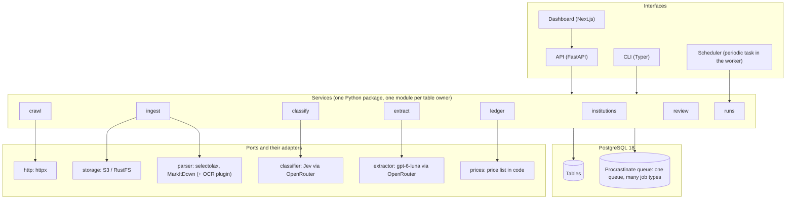

# 6. Architecture

- Architectural approach and reasons: a modular monolith in one Python package, one database,
  and workers that are the same process, all reading one queue. Modules own tables and expose a
  service function layer; nothing reaches another module's tables directly. Jobs are PostgreSQL
  rows (Procrastinate), so a job commits or rolls back with the data it is about and there is
  no broker to run. External concerns (HTTP fetching, object storage, parsing, classification,
  extraction models) sit behind one port each, so a provider can be swapped by configuration
  and faked in tests. This is the structure of Alloy, the template the repository starts
  from (section 3), chosen because it is already proven.
- Technologies and technical restrictions: Python 3.14, uv, FastAPI, Typer (CLI), SQLAlchemy 2
  async, Alembic, Procrastinate, PostgreSQL 18, Next.js 16 with shadcn/ui and TanStack Query for
  the dashboard (reusing Alloy's app shell and generated API client), httpx (HTTP/2, conditional
  requests), selectolax for HTML compaction, markdownify for HTML to markdown (the converter
  MarkItDown uses for HTML, so pages and files read alike), MarkItDown for PDF and office files
  with the `markitdown-ocr` plugin for scans, Pydantic for record types and structured outputs,
  Pydantic AI over OpenRouter for the extraction and OCR model (Alloy already ships it and
  records its calls), TypeSafe's Jev 1.14 for classification (through Pydantic AI if the
  Decisions API allows, else a thin httpx adapter behind the same port), RustFS locally as
  S3-compatible storage, Ruff, ty, pytest, Vitest. No browser for crawling: the target is
  server-rendered. Playwright stays a port that is not implemented.
- External systems and integrations: the target websites (createto.ca, a-us.storyblok.com,
  toronto.ca, partner hosts); OpenRouter, for `openai/gpt-6-luna` (extraction),
  `typesafe/jev-1.14` (classification, Decisions API) and OCR of scans (`openai/gpt-6-luna`);
  object storage (RustFS locally, a Railway S3-compatible bucket if hosted). One provider, one
  key, one client.
- Architecture or module diagram:

## institutions

- Responsibility: the subject rows and the two type enums; seeding the CreateTO institution.
- Data owned: `institutions`; the `InstitutionType` and `DocumentType` enums (code).
- Dependencies: none.
- Responsibilities outside this module: finding institutions (research) is not built.

## crawl

- Responsibility: the frontier and the fence. Decides what to fetch, when, and whether it is
  allowed: scope by host policy and institution prefix (on a `platform` host, the platform
  rule's URL patterns), robots, pacing, size and type caps,
  conditional requests. Writes the fetch log and hands bytes to `ingest`.
- Data owned: `domains`, `webpages`, `fetches`, `crawl_runs`.
- Dependencies: `http` port; `ingest` for storing; `institutions` for the website prefix.
- Responsibilities outside this module: parsing, classifying, extracting, counting.

## ingest

- Responsibility: snapshots. Writes bytes when the content hash is new, runs the parser
  registry to produce markdown per page, computes `text_hash`, and answers "give me the text of
  snapshot X page N" for everyone else.
- Data owned: `webpage_snapshots`; the object store layout.
- Dependencies: `storage` port; `parser` port (per media type).
- Responsibilities outside this module: deciding whether to fetch; meaning of the text.

## classify

- Responsibility: once per webpage, on its first snapshot with text, decide none / listing of
  type X / document of type X, with a confidence; create and update `sources` and `documents`,
  owned by the run's institution, including the `project_material` documents that `extract`
  asks for.
- Data owned: `classifications`, `sources`, `documents`.
- Dependencies: `classifier` port (Jev); `ingest` for text; `ledger`.
- Responsibilities outside this module: scheduling of sources is read by `crawl`; extraction.

## extract

- Responsibility: turn a document's current snapshot into records. Chooses rule or model,
  validates against the record type's Pydantic model, upserts records by document and key,
  writes a record snapshot on change, writes and verifies citations (the quote check). For a
  project, asks `classify` to upsert each file in its materials as a `project_material`
  document of that project.
- Data owned: `extractions`, `records`, `record_snapshots`, `citations`; the record type
  registry (Pydantic models in code); the platform rules (MERX), in code, keyed by host.
- Dependencies: `extractor` port (OpenRouter model); `ingest` for text; `classify` for
  documents and sources; `ledger`.
- Responsibilities outside this module: the cost itself; the schedule.

## ledger

- Responsibility: one row per paid call with cost computed from the price list in code.
- Data owned: `ai_calls`; the price list and its version.
- Dependencies: none. Called by `classify`, `extract` and any future worker.
- Responsibilities outside this module: deciding whether to call.

## review

- Responsibility: the review queue (a query over classifications and extractions below the
  thresholds with no review decision) and recording review decisions.
- Data owned: `review_decisions`.
- Dependencies: `classify` and `extract` for the items; settings for the thresholds.
- Responsibilities outside this module: what a rejection means is read by `crawl`, `extract`
  and `runs` (export) through the latest review decision.

## runs (report and export)

- Responsibility: create and control runs; the run report as queries; the JSON Lines export.
- Data owned: nothing beyond `crawl_runs` control fields (owned with `crawl`).
- Dependencies: reads every table.
- Responsibilities outside this module: none write-side.

## scheduler

- Responsibility: a Procrastinate periodic task, every minute, that creates runs when sources
  are due or a full run is overdue, at most one run per institution at a time.
- Data owned: nothing; reads `sources`, `crawl_runs`, `institutions`; writes `crawl_runs`
  through `runs`.
- Dependencies: runs.
- Responsibilities outside this module: executing the run.

## jobs

- Responsibility: the worker entry point, the queue, job locks, retry policy, and the
  scheduler's periodic task.
- Data owned: Procrastinate tables.
- Dependencies: every module's job functions.

## dashboard

- Responsibility: the browser interface: institutions, domains, runs with live progress, pages
  and fetches, documents, records with citations and history, the run report, the review queue.
  A separate Next.js app that only talks to the API.
- Data owned: none.
- Dependencies: the API's OpenAPI schema (generated client).
- Responsibilities outside this module: any computation; it displays what the API returns.
