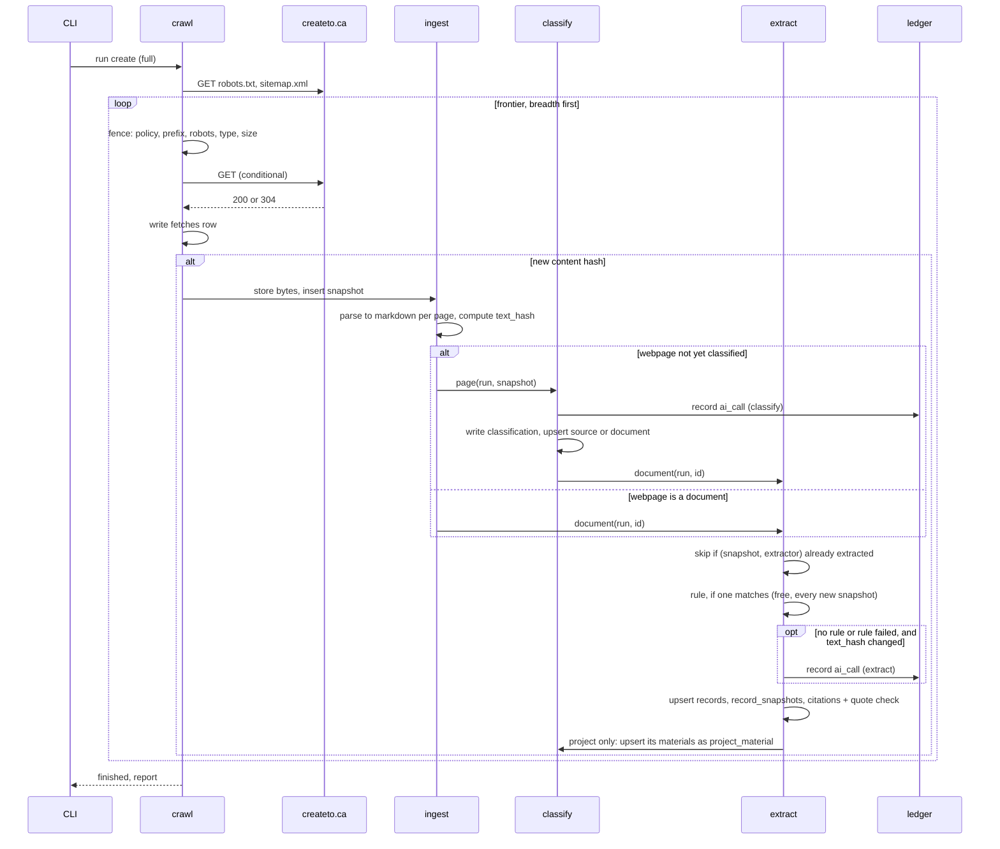

# 7. Behaviour

## Crawl, ingest, classify, extract (UC-001)

- Starting action or event: `gov-mine run create <institution> --full` inserts a `crawl_runs`
  row (`queued`) and enqueues `crawl.start(run_id)`.
- Participating modules: crawl, ingest, classify, extract, ledger, jobs.
- Steps and communication:
  1. `crawl.start` marks the run `running`, ensures the `domains` row for the website host
     (fetching robots.txt once), reads `sitemap.xml` if present to seed the frontier, and
     enqueues `crawl.fetch(run_id, webpage_id, depth=0)` for the homepage and the sitemap URLs
     (the run's seeds).
  2. `crawl.fetch`: a job whose run has already requested `--limit` webpages does nothing and
     writes no row (the URL was never attempted). Otherwise it applies the fence in order:
     private address, host policy, institution prefix, depth (more than 50 links from a seed:
     `skipped_depth`), robots, extension. A refusal writes a `fetches` row with the reason and
     stops; a private address is `skipped_scope` with reason `private_address`. Otherwise it
     sends a GET with `If-None-Match` and `If-Modified-Since` when known, and checks the
     response's `Content-Type` (`skipped_type`) and `Content-Length` (`skipped_size`, over 100
     MB) before reading the body; a body that streams past the cap is dropped as
     `skipped_size`. There is no separate HEAD request, so a page costs one request. A timeout,
     a 429 or a 5xx is retried three times with exponential backoff, each try its own `fetches`
     row; any other 4xx is one `failed_http` row, and a 404 sets `missing_since`. On a replay
     run every request goes to the replay server, whose own address passes the private-address
     check, and a URL outside the saved set is `skipped_scope` with reason `not_in_replay`.
     Fetch jobs carry a Procrastinate `lock` keyed by domain id, so one host is fetched one
     request at a time; the job waits out the host's delay (the default, or robots.txt's
     `Crawl-delay` when longer) since its last request before sending.
  3. On `200` with a new content hash, `ingest.store` writes bytes, inserts the snapshot and
     enqueues `ingest.parse(run_id, snapshot_id)`. On `304` or an unchanged hash the fetch is
     logged and nothing else happens. On an HTML page, links are extracted from the `<a href>`
     tags and from every other URL anywhere in the raw HTML, including inside scripts and
     embedded JSON (some sites link files only there); the fence filters out the noise. Each
     new URL gets a `webpages` row (`discovered_from_webpage_id`) and a `crawl.fetch` job one
     link deeper than the page it was found on; a video or audio link becomes a `youtube`
     document instead (section 5.4); links on `files_only` hosts are enqueued only when they
     look like files, and links on `platform` hosts only when the platform rule's patterns
     match them (for MERX: search tabs and pages, tender pages, award panels).
  4. `ingest.parse` runs the parser for the media type, writes `text/<id>/<page>`, sets
     `text_hash`, `text_status` and `stated_date`. On a `platform` host, the platform rule's
     matching pattern makes the webpage a source or a document of its type, without the
     classifier. Otherwise, if the webpage has no classification and is not a document yet, it
     enqueues `classify.page(run_id, snapshot_id)`. If the webpage is
     already a document, it enqueues `extract.document(run_id, document_id)` directly: a page
     is classified once.
  5. `classify.page` builds the input (URL, title, up to 100 links, and the markdown from the
     top, the whole request under 32,000 bytes), calls the classifier, writes a
     `classifications` row and an `ai_calls` row, and upserts a `sources` row (listing) or
     `documents` row (document) for the owning institution, with `document_date` from the
     snapshot's `stated_date`. A document enqueues `extract.document(run_id, document_id)`,
     unless it is dated before the run's cutoff.
  6. `extract.document` sets `document_date` from the snapshot's `stated_date` when it has one,
     and stops if that is before the run's cutoff. It looks for an extraction of this snapshot
     by this extractor; if one exists, stops. Otherwise runs the rule whose URL pattern matches
     the document's URL, on every new snapshot since a rule is free; or the model if none
     matches or the rule fails, but only when the snapshot is the document's first or its
     `text_hash` differs from the previous snapshot's. It validates, upserts records by
     document and key, writes `record_snapshots` on change, writes citations and runs the quote
     check on each. If the document has no `document_date`, it sets one from a date the
     extractor read in the text, if any. For a project, each file in its `materials` is
     upserted as a `project_material` document with `parent_document_id` set to the project,
     without the classifier; if the file was already classified, the project assignment wins.
  7. Every job carries the run's id. When no job with this `run_id` is left waiting or running
     in the queue, `crawl.finish` marks the run `finished`. The run is `failed` instead, with
     the error in `crawl_runs.error`, when the homepage on a full run, or every due listing
     page on an incremental run, ended `failed_*` with no snapshot. A job of a cancelled run
     does nothing when it starts.
- State changes and allowed transitions: `crawl_runs.status`: `queued → running → finished |
  failed`; `cancelled` from `queued` or `running`. `webpage_snapshots.text_status`: `parsing →
  ready | partial | failed | none`. There is no record status; a record's state is its latest
  record snapshot.
- Events or background work: one Procrastinate queue with the job types in section 8:
  `crawl.start`, `crawl.fetch`, `crawl.finish`, `ingest.parse`, `classify.page`,
  `extract.document` and the periodic `scheduler.tick` and `jobs.retry_stalled`. The worker
  runs several jobs at once, so a slow PDF does not stop fetching; paid work is capped by the
  run's cost ceiling: once the run's `ai_calls` cost passes `settings.max_cost`, no
  `classify.page` or model `extract.document` is enqueued and scanned PDF pages are not OCR'd
  (`text_status = partial`); fetching, parsing and rule extraction go on. Those pages wait
  until their content next changes. Whether a run hit its ceiling is a query (its ledger
  against `settings.max_cost`), shown as a warning.
- Failures, retries, and recovery: HTTP timeouts, 429s and 5xxs retry three times with
  exponential backoff, one `fetches` row per try, then end `failed_*`; other 4xxs do not
  retry. Parse failures do not retry (deterministic) and log `failed`. Model
  calls retry once on transport errors and never on validation errors (the fallback handles
  those). Jobs left running by a dead worker are put back in
  the queue by Alloy's stalled-job sweep (`jobs.retry_stalled`, every ten minutes), which
  finds them by their stopped heartbeat. A cancelled run leaves everything it wrote;
  snapshots are append-only.
- Sequence diagram:

## Scheduled re-run (UC-002)

- Starting action or event: the scheduler (UC-008) creates an incremental run when a source is
  due, or a full run when the institution's full interval has passed.
- Participating modules: crawl, ingest, classify, extract.
- Steps: an incremental run seeds its frontier from `sources` with `next_crawl_at <= now`
  (their listing pages), from `documents` under them, and from the sitemap's URLs not yet seen,
  not from the homepage. Listing pages are fetched; new links become new documents' webpages;
  known documents are fetched conditionally. The rest is the flow above.
  `sources.next_crawl_at` advances by `crawl_interval` when the source's listing page has been
  fetched.
- State changes: `webpages.missing_since` is set on 404 and cleared on a later 200.
- Failures: as above. A listing page that fails leaves `next_crawl_at` unchanged, so it is
  retried on the next scheduler tick.

## Scheduler (UC-008)

- Starting action or event: a Procrastinate periodic task (`@app.periodic`), every minute.
  Procrastinate defers each tick once however many workers run.
- Participating modules: scheduler, runs, crawl.
- Steps: one query lists institutions that are not paused, have no run in `queued` or
  `running`, and either have a source with `next_crawl_at <= now` (incremental) or whose last
  finished full run is older than the full interval (full). For each, `runs.create` inserts the
  run with `settings.trigger = scheduled` and enqueues `crawl.start`.
- State changes: none of its own; it only creates runs.
- Failures: the task logs any error and tries again on the next tick. A partial unique index on
  `crawl_runs (institution_id) WHERE status IN ('queued', 'running')` makes a second run for
  the same institution impossible, whoever creates it.
- Full-crawl interval: 30 days by default, as a column on `institutions`
  (`full_crawl_interval`) editable in the dashboard.

## Review (UC-009)

- Starting action or event: a reviewer opens Review in the dashboard.
- Participating modules: review, classify, extract.
- Steps: `review.queue` lists classifications and extractions below their thresholds with no
  review decision, oldest first. The reviewer approves or rejects each; `review.record` inserts
  a `review_decisions` row.
- State changes: none outside `review_decisions`. Everything else reads the latest review
  decision: the scheduler and incremental runs skip sources whose classification was rejected;
  extraction and export skip documents whose classification was rejected; `current_records` and
  export skip record snapshots whose extraction was rejected.
- Failures: a review decision on an item that already has one adds a newer review decision; the
  latest counts.

## Manual rerun of an extractor

- Starting action or event: `gov-mine extract --rerun --extractor <name> [--institution <id>]
  [--type <record_type>]`, after a prompt or rule changes and its version is bumped.
- Participating modules: extract, ledger.
- Steps: for every matching document, take its latest snapshot; if it already has an extraction
  by this extractor, skip it; otherwise enqueue `extract.document` with that extractor and
  no `run_id`.
  Extractions are written with no `crawl_run_id`; their cost is in `ai_calls`. A record
  snapshot is written only where the data changed.
- Rules: nothing reruns automatically when an extractor changes, so a prompt change never
  spends money on its own. `--dry-run` prints what would change without writing.

## Quote check (within extract)

- Starting action: a citation from a model extraction to verify. Rule citations skip it.
- Steps: load `text/<snapshot>/<page>`; strip markdown syntax from both sides; fold case,
  collapse whitespace, normalise typographic punctuation; require the excerpt to appear whole,
  on word boundaries, at least twelve characters; on failure try once with all whitespace
  removed. Set `verified`. This is Public Atlas's check, copied from
  `../public-atlas/apps/server/src/public_atlas/modules/evidence/quote_checks.py` (next to this
  repository), as is its checked-string enum helper.
